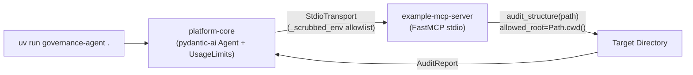

# template-ai-monorepo

A production-minded template for AI/agentic Python monorepos, managed as a single `uv` workspace. The worked example is a `pydantic-ai` governance-audit agent (`platform-core`) that reaches a path-confined tool through an MCP server (`example-mcp-server`) over stdio, demonstrating a self-checking governance audit end to end.

[](https://github.com/Astenuprax/template-ai-monorepo/actions/workflows/ci.yml)
[](LICENSE)
[](https://www.python.org/downloads/)

## Architecture



## Quick start

```bash
uv sync --all-packages
uv run governance-agent .
```

`uv sync --all-packages` resolves and installs every workspace member into one shared environment. `uv run governance-agent .` runs the agent against the current directory (falling back to a direct MCP stdio round-trip when `ANTHROPIC_API_KEY` is unset):

```text
[no ANTHROPIC_API_KEY -> direct MCP round-trip]
AuditReport(target='.../template-ai-monorepo', conforms=True, present=['README.md', 'pyproject.toml', 'LICENSE'], missing=[])
```

## Layout

```text
.
├── packages/
│   └── platform-core/         # pydantic-ai governance-audit agent
├── services/
│   └── example-mcp-server/    # MCP server (stdio) + non-root Dockerfile
├── tests/                     # unit, integration, and test_structure.py gate
├── docs/                      # architecture, ADRs, and THREAT_MODEL.md
└── .github/                   # CI (check, gate, sbom, osv-scan, actionlint)
```

## Quality gate & security

```bash
uvx pre-commit run --all-files
```

| Control | Enforced by | Scope |
| --- | --- | --- |
| Lint & format | `ruff check` / `ruff format --check` | Workspace `packages/`, `services/`, `tests/` |
| Strict typing | `pyright` (`typeCheckingMode = "strict"`) | `packages/`, `services/`, `tests/` (`py.typed` required) |
| Unit & integration tests | `pytest` + `pytest -m integration` | Agent factory, `allowed_root` path jail, live stdio MCP |
| Structure & hygiene | `tests/test_structure.py` | Root furniture, `docs/` frontmatter, SHA-pinned Actions |
| Supply-chain & secrets | `.github/workflows/ci.yml` | `osv-scanner` (`uv.lock`), CycloneDX SBOM, `gitleaks`, `actionlint` |

See [`AGENTS.md`](AGENTS.md) for the agent-facing contract and [`docs/THREAT_MODEL.md`](docs/THREAT_MODEL.md) for trust boundaries and implemented mitigations.

## License

Apache-2.0. See [`LICENSE`](LICENSE) for the full text and [`NOTICE`](NOTICE) for attribution.
